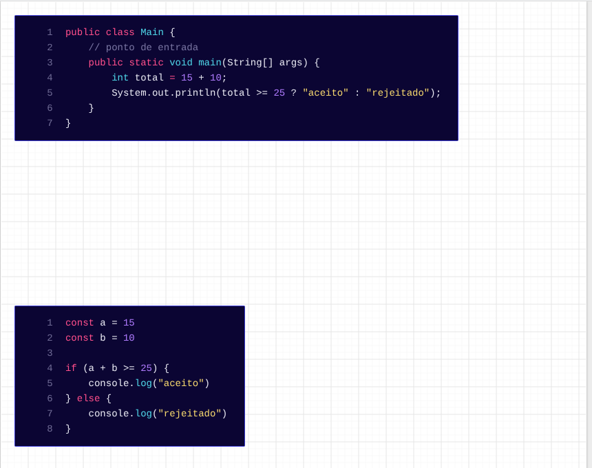

# Codeblock para draw.io

Bloco de código para diagramas do draw.io, com seleção de linguagem, realce de sintaxe, tema e numeração de linhas, no estilo do bloco de código do Miro e do Jira.



## Conteúdo desta pasta

| Arquivo | Para que serve |
|---|---|
| `drawio-codeblock-1.0.1.vsix` | Extensão do VS Code. É a forma recomendada de instalar e de distribuir para outros devs. |
| `codeblock.js` | O plugin em si, já empacotado. Usado pela extensão e por versões do draw.io Desktop que aceitam plugins externos. |
| `source/` | Código-fonte do plugin e da extensão, e o script `build.sh` que gera os dois arquivos acima. |

## Compatibilidade

| Onde | Suporte |
|---|---|
| VS Code + extensão **Draw.io Integration** (`hediet.vscode-drawio`) | Sim, permanente, via `.vsix` |
| draw.io Desktop até a versão de junho/2026 | Sim, abrindo o app com `--enable-plugins` |
| draw.io Desktop a partir de julho/2026 | Não. O app carrega apenas plugins embutidos. |
| app.diagrams.net (web) | Não. A versão web não carrega plugins externos. |

Os diagramas ficam coloridos em **qualquer** draw.io, mesmo sem o plugin: as cores são gravadas no próprio arquivo. O plugin só é necessário para criar e editar os blocos.

---

## Instalação no VS Code (recomendado)

### Pré-requisito

Extensão **Draw.io Integration**, do autor Henning Dieterichs (`hediet.vscode-drawio`). Se ela não estiver instalada, o VS Code a instala automaticamente junto com o Codeblock.

### Pela interface

1. Abra o VS Code.
2. Abra a aba **Extensões** (`Cmd+Shift+X` no Mac, `Ctrl+Shift+X` no Windows/Linux).
3. Clique no menu **`...`** no topo da aba e escolha **Install from VSIX...**.
4. Selecione o arquivo `drawio-codeblock-1.0.1.vsix`.
5. Quando o VS Code pedir, clique em **Reload** (ou feche e abra o VS Code).

### Pelo terminal

```bash
code --install-extension drawio-codeblock-1.0.1.vsix
```

### Conferindo a instalação

1. Crie ou abra um arquivo `.drawio` (ou `.drawio.svg` / `.drawio.png`) no VS Code. Ele abre no editor do draw.io.
2. A barra de formas à esquerda tem a seção **Bloco de código**, e o menu **Extras** tem o item **Bloco de código...** no final.

### Atualizando

Instale o `.vsix` da nova versão por cima, pelo mesmo procedimento. Não é preciso desinstalar antes.

### Desinstalando

Na aba **Extensões**, procure por **Draw.io Code Block** e clique em **Uninstall**.

---

## Uso

| Ação | Como fazer |
|---|---|
| Inserir pela barra lateral | Seção **Bloco de código** na barra de formas à esquerda: clique no item para abrir o editor, ou arraste-o até o diagrama para inserir o bloco onde soltar |
| Inserir pelo menu | **Extras → Bloco de código...**, atalho `Cmd+Shift+K` (Mac) / `Ctrl+Shift+K` (Windows/Linux), ou botão direito no canvas → **Inserir bloco de código...** |
| Editar um bloco | Duplo clique no bloco, ou botão direito → **Editar código...** |
| Aplicar as alterações | Botão **Inserir** / **Aplicar**, ou `Cmd+Enter` / `Ctrl+Enter` |

No editor do bloco:

- **Linguagem:** JavaScript, TypeScript, Java, Kotlin, Go, Python, C#, Rust, PHP, Ruby, Scala, Swift, C/C++, SQL, JSON, YAML, HTML/XML, Bash, Dockerfile, GraphQL, Protobuf, texto puro, ou detecção automática.
- **Tema:** Miro (escuro), GitHub (escuro), GitHub (claro).
- **Fonte:** tamanho de 8 a 40 px.
- **Números de linha:** liga e desliga a coluna de numeração.
- A pré-visualização à direita é atualizada enquanto você digita, e `Tab` insere 4 espaços.

O bloco se redimensiona automaticamente para caber o código. Exportações para PNG, SVG e PDF saem com as cores.

---

## Distribuindo para outros devs

**Compartilhar o arquivo.** Envie o `drawio-codeblock-1.0.1.vsix` (por repositório, Slack, Drive etc.) junto com a seção [Instalação no VS Code](#instalação-no-vs-code-recomendado).

**Recomendar no repositório.** Em repositórios que guardam diagramas `.drawio`, adicione o `.vsix` ao repositório e crie o arquivo `.vscode/extensions.json`:

```json
{
  "recommendations": ["hediet.vscode-drawio"]
}
```

Quem abrir o repositório recebe a sugestão do Draw.io Integration. O Codeblock continua sendo instalado pelo `.vsix`.

**Publicar em um marketplace.** Para instalar pela busca de extensões do próprio VS Code, publique a extensão no [Visual Studio Marketplace](https://marketplace.visualstudio.com/manage) e/ou no [Open VSX](https://open-vsx.org/) (usado pelo Cursor, VSCodium e outros). Os dois exigem uma conta de publisher; o campo `publisher` em `source/vscode-extension/package.json` precisa ser o ID dessa conta.

---

## Gerando uma nova versão

Requisitos: Node.js 18+ e `zip`.

1. Edite o plugin em `source/plugin/codeblock.src.js`.
2. Aumente o campo `version` em `source/vscode-extension/package.json` (por exemplo, `1.0.0` → `1.1.0`).
3. Rode:

   ```bash
   ./source/build.sh
   ```

O script gera o `codeblock.js` e o `drawio-codeblock-<versão>.vsix` nesta pasta.

---

## draw.io Desktop até junho/2026

Versões do draw.io Desktop lançadas até junho/2026 aceitam plugins externos quando abertas com o parâmetro `--enable-plugins`.

### Instalação

1. Feche o draw.io completamente (no Mac, `Cmd+Q`).
2. Abra o draw.io com plugins habilitados (veja a seção abaixo).
3. Vá em **Extras → Extensões...** (em inglês, **Extras → Plugins...**), clique em **Adicionar** e selecione o `codeblock.js`.
4. Feche e abra de novo o draw.io com plugins habilitados.
5. Confira se **Extras** tem o item **Bloco de código...** no final.

Se a janela de extensões mostrar *"External plugins disabled"*, o app foi aberto sem o parâmetro, ou é uma versão sem suporte a plugins externos.

### Abrindo o draw.io com plugins habilitados

Feche todas as instâncias do draw.io antes de rodar o comando. Se o app já estiver aberto, o parâmetro é ignorado.

#### Mac

```bash
/Applications/draw.io.app/Contents/MacOS/draw.io --enable-plugins
```

Alias para não digitar o caminho toda vez:

```bash
echo "alias drawio='/Applications/draw.io.app/Contents/MacOS/draw.io --enable-plugins >/dev/null 2>&1 &'" >> ~/.zshrc
source ~/.zshrc
```

#### Linux

| Instalação | Comando |
|---|---|
| Pacote `.deb` / `.rpm` | `drawio --enable-plugins` |
| AppImage | `./drawio-x86_64-<versão>.AppImage --enable-plugins` |
| Snap | `snap run drawio --enable-plugins` |
| Flatpak | `flatpak run com.jgraph.drawio.desktop --enable-plugins` |

Atalho no menu de aplicativos já com o parâmetro:

```bash
mkdir -p ~/.local/share/applications
cp /usr/share/applications/drawio.desktop ~/.local/share/applications/
sed -i 's|^Exec=\([^ ]*\)|Exec=\1 --enable-plugins|' ~/.local/share/applications/drawio.desktop
```

#### Windows

PowerShell:

```powershell
& "C:\Program Files\draw.io\draw.io.exe" --enable-plugins
```

Prompt de Comando (cmd):

```bat
"C:\Program Files\draw.io\draw.io.exe" --enable-plugins
```

Instalação apenas para o usuário: `%LOCALAPPDATA%\Programs\draw.io\draw.io.exe`.

Atalho fixo: botão direito no atalho do draw.io → **Propriedades** → no campo **Destino**, acrescente ` --enable-plugins` depois das aspas → **OK**.
