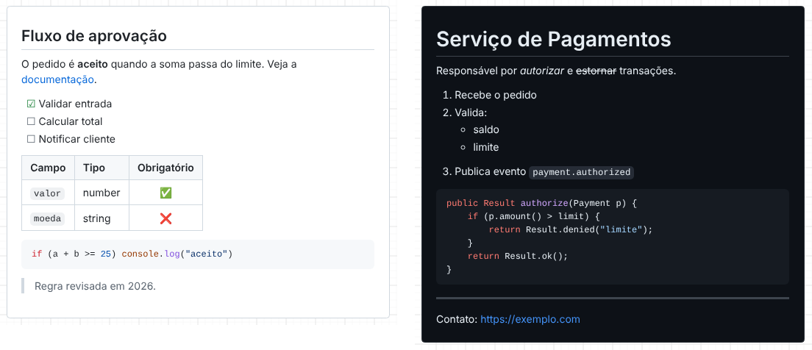

# 📝 Markdown para draw.io

Bloco que **interpreta Markdown** e exibe o resultado formatado dentro dos seus diagramas.



## ✅ O que é suportado

| Recurso | Sintaxe |
|---|---|
| Títulos | `#`, `##`, `###` ... |
| Negrito, itálico, riscado | `**negrito**`, `*itálico*`, `~~riscado~~` |
| Listas e listas aninhadas | `- item`, `1. item` |
| Tarefas | `- [ ] a fazer`, `- [x] feito` |
| Tabelas (com alinhamento) | `\| a \| b \|` + `\|---\|:---:\|` |
| Código inline e em bloco (com cores) | `` `código` ``, ` ```java ` |
| Citações | `> texto` |
| Links e URLs automáticas | `[texto](url)`, `https://...` |
| Linha horizontal | `---` |

## 📦 Instalação

| Onde | Como |
|---|---|
| 🐳 draw.io em Docker (pasta `Template`) | Já vem ativo. Após atualizar, rode `docker compose restart` |
| 💻 VS Code + Draw.io Integration | `code --install-extension caminho/para/plugins/Markdown/drawio-markdown-1.0.0.vsix` e depois **Developer: Reload Window** |

## 🚀 Como usar

| Ação | Como |
|---|---|
| ➕ Inserir | Barra lateral → **Markdown** (clique ou arraste) |
| ➕ Inserir (atalho) | `Cmd+Shift+X` / `Ctrl+Shift+X` ou **Extras → Markdown...** |
| ✏️ Editar | Duplo clique no bloco |
| 💾 Aplicar | `Cmd+Enter` / `Ctrl+Enter` |

No editor você escolhe **tema** (Claro, Escuro, Sem fundo), **tamanho da fonte** e **largura**. A altura se ajusta sozinha ao conteúdo.

> 💡 O bloco aparece formatado em **qualquer** draw.io, mesmo sem o plugin. O plugin só é necessário para criar e editar.

## 🛠️ Para quem mantém

1. Edite `source/plugin/markdown.src.js`
2. Aumente `version` em `source/vscode-extension/package.json`
3. Rode `./source/build.sh` (requer Node.js 18+ e `zip`)
